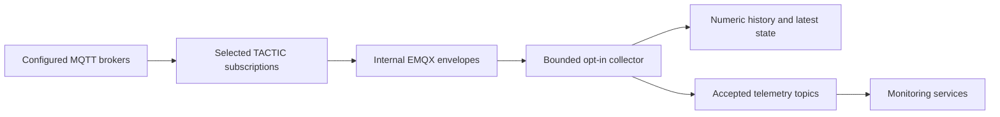

# Catalogue and collection

**Data sources** opens a dedicated broker/topic/reading workspace. Select a broker or topic folder to inspect its recording scope; catalogue editing is available in its settings. Verified administrators can save
brokers, entities, concrete MQTT topics, payload fields and catalogue groups;
members can inspect them. The installation-wide database is authoritative.
Export/import uses only `aberration-system` schema version 1. Credentials, host
allowlists, TLS requirements and private network routes stay with the operator.

## Data path

Upstream topics are arbitrary concrete MQTT paths. Several readings may extract
different JSON Pointer fields from one topic. Catalogue IDs identify definitions;
saved runtime bindings identify their entity and reading in storage. Rename a
definition without changing its ID to retain its binding and monitor association.
Accepted numeric observations use `telemetry/<entity>/<reading>` and the existing
`{value, timestamp}` payload. The collector never subscribes to its own output.

Persistent subscriptions run independently of views and login sessions. Temporary
**Connect** previews use bounded memory and do not enable recording. Opening a
recorded reading loads existing history, then follows new stored observations.

## Explicit collection

Broker and topic rules inherit to registered readings, with explicit child exceptions.
Choose Off, Sample (1–3600 seconds), or Original, review the automatic preview,
and Apply once. **Include future registered readings** is unchecked by default;
new or moved readings stay Off and are marked for review until explicitly included.
Changing a parent's cadence does not silently admit them. Importing enabled file
policies cannot activate collection. Existing enabled legacy readings retain explicit
leaf overrides. Rules match exact MQTT segments, including case and empty segments;
they do not discover unknown broker topics or enable wildcard firehoses.

Drafts are scoped to one broker. Leaving requires Apply, Discard, or Stay. Undo
stages the previous rule set only while both catalogue and collection revisions
still match; it cannot restore deleted history or restart stopped monitors.
Hierarchical rules and admission metadata persist with the operational database;
version-1 catalogue exports contain effective leaf policies, not operational rules. Changes
to admitted inputs or cadence require stopping affected active monitors before
applying; their settings remain available for restart.

- **Off:** no persistent subscription, storage or accepted output for the input.
- **Original rate:** fresh numeric observations enter a bounded queue. Overload
  drops new observations and increments the drop counter. This is best-effort
  telemetry rather than a durable lossless transport.
- **Sample:** emit the latest pending observation when its interval becomes due,
  retaining its observation timestamp. Quiet streams are not filled or repeated.
- **Boolean, text and identifier:** persist latest state only; original-rate
  state updates are coalesced to at most one per second. These do not enter numeric
  history or the detector feed.
- **Retained snapshots:** update latest state without becoming fresh history or
  detector input. Only fresh admitted observations update entity contact status.

The initial definition limits are 128 brokers, 2,048 entities, 4,096 readings,
128 groups and 1 MiB. The original-rate queue defaults to 10,000 observations.
Decode, coalescing and overload counters are visible in diagnostics. Database
backpressure retains bounded pending batches. Process loss can lose memory queues;
accepted MQTT output is not transactionally coupled to a database commit.

## Applying configuration

Saves use an expected revision and a PostgreSQL advisory lock. Concurrent edits
receive a conflict. Monitor starts use the same lock to prevent changes racing
with input claims. Monitor stop intent commits before workload removal; completed
stops remain durable even if a later stop or catalogue save fails.

The collector pauses admission, drains pending database and MQTT output, installs
the new subscriptions and reports `prepared`. TACTIC then establishes selected
broker subscriptions for that configuration generation. After matching ingress
is applied, the collector enables admission. Failure remains visible and retries;
an empty selection is healthy idle. Old queued generations cannot enter a new
mapping. Turning an input Off preserves previously recorded history.

## Upgrade from the previous runtime

Use the production release's packaged migration workflow; do not execute SQL
files individually or reset the database. Application writers stop before schema
changes, and the release captures monitor restart configuration.

Migration `005_generic_runtime.sql` converts saved catalogue and monitor topic
configuration once. Stable bindings, names, explicit policies, accounts,
favourites and model settings survive. Existing sensor measurements (`telemetry`)
and latest values (`collection_state`) remain, alongside catalogue revisions,
monitoring evidence and other records. Stable storage identities make that
possible without a legacy runtime or a separate data archive. Recording and
retention continue unchanged.

The generic runtime is the sole operational model. Retired catalogue APIs,
provider-specific imports and old accepted topics are not supported. Before
starting generic ingress, the controller removes only its generated v1
`offkey_ambibox_` EMQX/GOST resources. Operator-authored routes remain intact.

## Operator access and retention

`SYSTEM_COLLECTION_ENABLED` controls persistent ingress independently of
`SYSTEM_LIVE_ENABLED`. Generic broker allowlists, credential references and optional
SOCKS routes are private operator configuration. Existing Ambibox operator access
can still supply its configured credentials, registered tailnet route and TLS
requirement to allowed hosts; the application model is independent of that
provider. Catalogue exports contain no credentials.

Internal publishing uses the configured EMQX TLS/authentication defaults and the
private `SYSTEM_COLLECTION_MQTT_USERNAME`, `SYSTEM_COLLECTION_MQTT_API_KEY` and
`SYSTEM_COLLECTION_MQTT_CA_FILE`. Production mounts its publisher credential and
CA as TACTIC secrets. Settings reports ingress/collector revisions and diagnostics.

Storage diagnostics remain under **Settings**. `TELEMETRY_RETENTION_DAYS` (1–365,
default 14) controls managed TimescaleDB retention for telemetry and monitoring
evidence. DB sync reconciles those policies on startup without changing other
jobs. Shortening retention makes old chunks eligible for scheduled cleanup; it
does not affect accounts, catalogues or anomalies. Increasing retention cannot
recover data already removed.

For local MQTT examples and private catalogue simulation, see
[Local deployment](../development/local-deployment.md).
