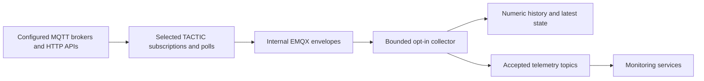

# Catalogue and collection

**Sources** opens a dedicated broker/topic/reading workspace. Select a broker or topic folder to inspect its recording scope; catalogue editing is available in its settings. Verified members whose role manages sources can save
brokers, entities, concrete MQTT topics, payload fields and collections;
members can inspect them. A broker entry is either an MQTT broker or an
[HTTP API](#http-sources) that is polled. The installation-wide database is authoritative.
Export/import uses only `aberration-system` schema version 1. Credentials, host
allowlists, TLS requirements and private network routes stay with the operator.

## Data path

Upstream topics are arbitrary concrete MQTT paths. Several readings may extract
different JSON Pointer fields from one topic. Catalogue IDs identify definitions;
saved runtime bindings identify their entity and reading in storage. Rename a
definition without changing its ID to retain its binding and monitor association.
Accepted numeric observations use `telemetry/<entity>/<reading>` and the existing
`{value, timestamp}` payload. The collector never subscribes to its own output.

Persistent subscriptions run independently of views and login sessions. Temporary
**Connect** previews use bounded memory and do not enable recording. Opening a
recorded reading loads existing history, then follows new stored observations.

## HTTP sources

A broker entry of type **HTTP API** is a server that TACTIC asks, instead of a
broker that sends. It saves a host, a port and whether to use TLS. Each reading
names a request path with an optional query, such as
`/v1/stations/7/latest?units=metric`, and the JSON Pointer of its value in the
reply. Readings that share a path share one request. From there a reply is
handled like an MQTT message: the same payload decoding, the same collector and
the same history. Numbers sent as JSON strings, such as `"21.5"`, are accepted
for number readings from either kind of source.

TACTIC sends `GET` requests only, to the saved host and port only. It does not
follow redirects, reads at most 64 KiB of a reply and keeps one connection open
per source. A path starts with `/` and holds no spaces, `+` or `#`;
percent-encode those characters.

- **Polling rate:** a source sends nothing by itself, so its readings record at
  an interval and never at Original rate. Each path is asked as often as its
  most frequent recorded reading samples, and never more often than
  `SYSTEM_HTTP_MIN_POLL_SECONDS`. A **View live** preview asks every 5 seconds,
  or that minimum if it is longer.
- **Source timestamp:** many APIs repeat their latest measurement until a new
  one exists. Give the reading the JSON Pointer of the time the reply states,
  such as `/observed_at`, and a poll that repeats that time is not recorded
  again. The recorded time stays the time of the poll that first saw the value.
  Previews show every poll.
- **Refusals:** `401` and `403` stop the source at once. So does a source whose
  every path answers a redirect or another client error. It reports the answer
  and is tried again after five minutes, then less often, up to once an hour;
  **Reconnect recording** tries at once. A login that was refused is therefore
  not sent again every few seconds.
- **Outages:** server errors, `408`, `429` and network failures are retried
  with backoff, and `Retry-After` is honoured up to one hour. One failing path
  is asked less often, up to every five minutes, while the others continue; the
  source reports how many paths return no data.

HTTP sources have their own operator settings:

| Setting | Purpose |
| --- | --- |
| `SYSTEM_HTTP_ALLOWED_ORIGINS` | JSON list of origins, such as `["https://api.example.com", "http://10.0.0.7:8080"]`. An origin fixes scheme, host and port, so a catalogue edit can neither reach another port nor turn TLS off |
| `SYSTEM_HTTP_CREDENTIALS` | Private JSON mapping from a credential reference to one login. `{"token": "…"}` sends `Authorization: Bearer …`; `{"username": "…", "password": "…"}` sends Basic authentication; `{"token": "…", "header": "X-API-Key"}` sends the token as written under that header |
| `SYSTEM_HTTP_MIN_POLL_SECONDS` | Shortest time between two requests for one path (default 1) |

`SYSTEM_LIVE_ALLOWED_HOSTS`, `SYSTEM_LIVE_CREDENTIALS` and broker routes never
apply to an HTTP source, so an MQTT login is never sent in a request header. A
host listed in `SYSTEM_LIVE_SOCKS_PROXIES` is reached through that SOCKS5 proxy
with either protocol; that is how an API inside a source network is reached.
TLS uses the system CA store and checks the host name, with no option to skip
it. A deployment sets `system_http_allowed_origins` in its inventory and
`system_http_credentials` in its vault.

**Check connections** sends one request for the path of the source's first
reading. Without a reading it asks for `/`, and any answer except `401` shows
that the server is there.

## Explicit collection

Broker and topic rules inherit to registered readings, with explicit child exceptions.
Choose Off, Sample (1–3600 seconds), or Original, review the automatic preview,
and Apply once. **Include future registered readings** is unchecked by default;
new readings stay Off and are marked for review until explicitly included.
Moving a reading to another broker or topic invalidates its inherited admission;
it needs review again unless its new scope includes future readings. Explicit
reading policies survive topic changes by stable ID. Including current readings
can be combined with a parent policy change in one Apply action.
Changing a parent's cadence does not silently admit them. Importing enabled file
policies cannot activate collection. Existing enabled legacy readings retain explicit
leaf overrides. Rules match exact MQTT segments, including case and empty segments;
they do not discover unknown broker topics or enable wildcard firehoses.

Drafts are scoped to one broker. Leaving requires Apply, Discard, or Stay. Undo
stages the previous rule set only while both catalogue and collection revisions
still match; it cannot restore deleted history or restart stopped monitors.
Hierarchical rules and admission metadata persist with the operational database;
version-1 catalogue exports contain effective leaf policies, not operational rules. Changes
to admitted inputs or cadence require stopping affected active monitors before
applying; their settings remain available for restart.

- **Off:** no persistent subscription, storage or accepted output for the input.
- **Original rate:** fresh numeric observations enter a bounded queue. Overload
  drops new observations and increments the drop counter. This is best-effort
  telemetry rather than a durable lossless transport.
- **Sample:** emit the latest pending observation when its interval becomes due,
  retaining its observation timestamp. Quiet streams are not filled or repeated.
- **Boolean, text and identifier:** persist latest state only; original-rate
  state updates are coalesced to at most one per second. These do not enter numeric
  history or the detector feed.
- **Retained snapshots:** update latest state without becoming fresh history or
  detector input. Only fresh admitted observations update entity contact status.
  Ingress retains the latest envelope per selected input inside EMQX. Activation
  and reconnect replay it as a snapshot, including when its original delivery
  arrived while the collector was paused. Retired generation topics are cleared
  when ingress applies the next configuration.

The initial definition limits are 128 brokers, 2,048 entities, 4,096 readings,
128 groups and 1 MiB. The original-rate queue defaults to 10,000 observations.
Decode, coalescing and overload counters are visible in diagnostics. Database
backpressure retains bounded pending batches. Process loss can lose memory queues;
accepted MQTT output is not transactionally coupled to a database commit.
Ingress also bounds its forwarding queue to 512 messages and 8 MiB. Device online
status requires current collection workers and recent fresh receipts; stored
contact timestamps alone do not keep a silent device online.

## Applying configuration

Saves use an expected revision and a PostgreSQL advisory lock. Concurrent edits
receive a conflict. Monitor starts use the same lock to prevent changes racing
with input claims. Monitor stop intent commits before workload removal; completed
stops remain durable even if a later stop or catalogue save fails.

The collector pauses admission, drains pending database and MQTT output, installs
the new subscriptions and reports `prepared`. TACTIC then establishes selected
broker subscriptions for that configuration generation. After matching ingress
is applied, the collector enables admission. Failure remains visible and retries;
an empty selection is healthy idle. Old queued generations cannot enter a new
mapping. Turning an input Off preserves previously recorded history.

Ingress and collection each retain a database ownership connection. Every write
and publication batch takes a transaction fence and verifies that owner; takeover
waits for outstanding fences. MQTT fences remain held through acknowledgement,
and uncertain publications close their transport before releasing the fence.
Callbacks and queued messages from replaced upstream clients are rejected.

The collector's reconciliation loop is the only reconnect owner for the local
broker. When the connection drops it pauses admission, reports `error` and
reconnects on its next poll, about every two seconds, without an attempt
cutoff; the MQTT client itself never retries. A new connection is a new
subscription generation, so the collector reinstalls its subscriptions and
re-requests retained snapshots before admitting again.

## Upgrade from the previous runtime

Use the production release's packaged migration workflow; do not execute SQL
files individually or reset the database. Application writers stop before schema
changes, and the release captures monitor restart configuration.

Migration `005_generic_runtime.sql` converts saved catalogue and monitor topic
configuration once. Stable bindings, names, explicit policies, accounts,
favourites and model settings survive. Existing sensor measurements (`telemetry`)
and latest values (`collection_state`) remain, alongside catalogue revisions,
monitoring evidence and other records. Stable storage identities make that
possible without a legacy runtime or a separate data archive. Recording and
retention continue unchanged.

The generic runtime is the sole operational model. Retired catalogue APIs,
provider-specific imports and old accepted topics are not supported.

## Operator access and retention

`SYSTEM_COLLECTION_ENABLED` controls persistent ingress independently of
`SYSTEM_LIVE_ENABLED`. Broker allowlists, HTTP origins, credential references,
SOCKS routes and broker routes are private operator configuration; the
application model names no source. Catalogue exports contain no credentials.

Internal publishing uses the configured EMQX TLS/authentication defaults and the
private `SYSTEM_COLLECTION_MQTT_USERNAME`, `SYSTEM_COLLECTION_MQTT_API_KEY` and
`SYSTEM_COLLECTION_MQTT_CA_FILE`. Production mounts its publisher credential and
CA as TACTIC secrets. System status reports ingress/collector revisions and diagnostics.

Storage diagnostics are under **System status** in the sidebar's account menu (`?settings=status`; `/system/status` still opens it). `TELEMETRY_RETENTION_DAYS` (1–365,
default 14) controls managed TimescaleDB retention for telemetry, monitoring
evidence and anomalies. DB sync reconciles those policies on startup without
changing other jobs. Shortening retention makes old data eligible for scheduled
cleanup; it does not affect accounts or catalogues. Increasing retention cannot
recover data already removed.

`TELEMETRY_STORAGE_CAP_GB` (optional) adds a storage ceiling for telemetry and
monitoring evidence. While their size exceeds the cap, a job running every 15
minutes drops the oldest completed daily chunk, logging a warning for each drop,
so history can be shorter than the retention window. Data from the current day
is never dropped. Telemetry and evidence use daily chunks for new data;
existing chunks keep their original seven-day span until they expire.

## Broker routes

A broker route reaches the brokers of one source network. It names the hosts or
host suffixes it covers, the SOCKS5 proxy into that network, an optional MQTT
login and whether TLS is required. TACTIC reads all routes from the private
`SYSTEM_BROKER_ROUTES` secret; the first route that covers a broker's host wins,
and explicit `SYSTEM_LIVE_CREDENTIALS` / `SYSTEM_LIVE_SOCKS_PROXIES` entries take
precedence. Brokers reachable directly need no route, only an allowlist entry.

A deployment configures its route in the inventory and vault:

| Setting | Where | Purpose |
| --- | --- | --- |
| `broker_route_enabled` | inventory | Deploy the `broker-route` node and route (default off) |
| `broker_route_name` | inventory | Lowercase name that tells routes apart in the secret |
| `broker_route_hosts`, `broker_route_host_suffixes` | inventory | Covered hosts; each suffix starts with a dot |
| `broker_route_require_tls` | inventory | Force TLS for covered brokers |
| `broker_route_tailscale_extra_args`, `broker_route_tailscale_hostname` | inventory | How the node joins the source network (login server, tags, name) |
| `broker_route_state_dir`, `broker_route_seed_dir` | inventory | Where the node identity lives on the manager's NFS export and its private seed |
| `broker_route_mqtt_username`, `broker_route_mqtt_password` | vault | Login for covered brokers; `broker_route_anonymous: true` allows none |

The `broker-route` node is a singleton Tailscale device with a pre-seeded
identity (no auth key) that offers SOCKS5 on port 1055 to TACTIC. Switching to
another source changes only these values, the identity seed and the Sources
catalogue. A network reached another way needs only another node behind the same
SOCKS5 contract; TACTIC does not change.

Deployments never register a node, so a new source network needs its identity
created once by an operator:

1. On a trusted machine, run the pinned Tailscale image with an empty state
   directory, the same `TS_EXTRA_ARGS` and `TS_HOSTNAME` as the inventory, and
   the auth key or interactive login the source network's operator provides.
2. Stop the container once the node shows as connected, and confirm the source
   network lists it. Never start that state anywhere else while it is in use.
3. Copy the resulting `tailscaled.state` into the inventory's
   `broker_route_seed_dir` on the control host. The next deployment seeds the
   empty NFS export from it; an existing identity there is never overwritten.

## MQTT client policy

[HTTP sources](#http-sources) use no MQTT client upstream; from the ingress
publisher on they share this path. The services use separate Paho clients. Their connection policies differ on
purpose in some places and have drifted in others; this table is the current
record, so a change to one client is visible against the rest.

| Client | Keepalive | TLS | Reconnect owner and give-up | Ready when | Payload limit |
| --- | --- | --- | --- | --- | --- |
| TACTIC upstream readers | 30 s | system CA store | Paho, 1–30 s backoff; ingress has no cutoff, the live view ends a broker after `SYSTEM_LIVE_CONNECT_TIMEOUT_SECONDS` (15 s) | every subscription acknowledged | ingress forwards payloads up to 64 KiB |
| TACTIC ingress publisher | 30 s | configured CA file | Paho, 1–30 s backoff, no cutoff | connected | one envelope per forwarded payload |
| Collection worker | 15 s | configured CA file | collection loop, about every 2 s, no cutoff | connected and catalogue applied | envelopes up to six times the payload limit; payloads up to 64 KiB |

A refused connection (wrong credentials or permissions) is retried on the same
schedule as an outage, so the broker sees the same credentials again.

RADAR monitors have no MQTT client. Each reads its readings from the stored
telemetry log, in the order the collection worker committed them, and saves the
position it reached with its checkpoint; see [RADAR recovery](radar-recovery.md).

For local MQTT examples and private catalogue simulation, see
[Local deployment](../development/local-deployment.md).
