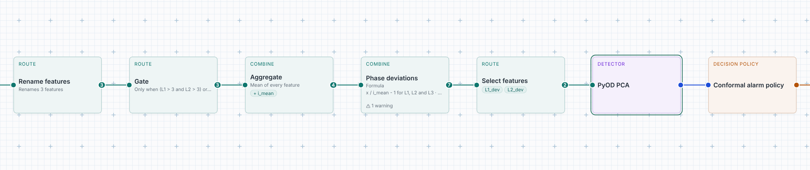
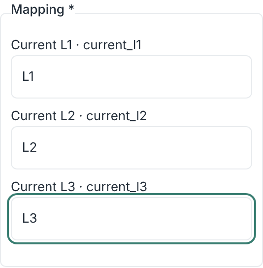
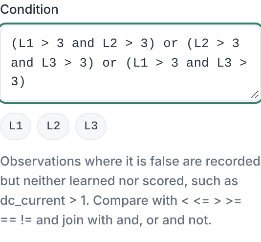
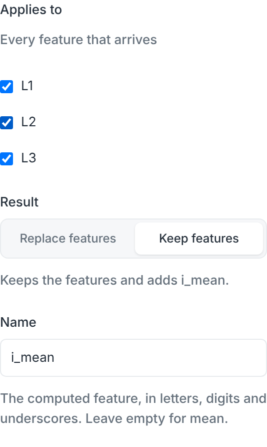
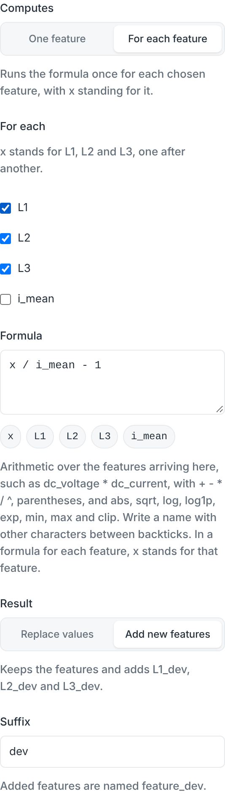
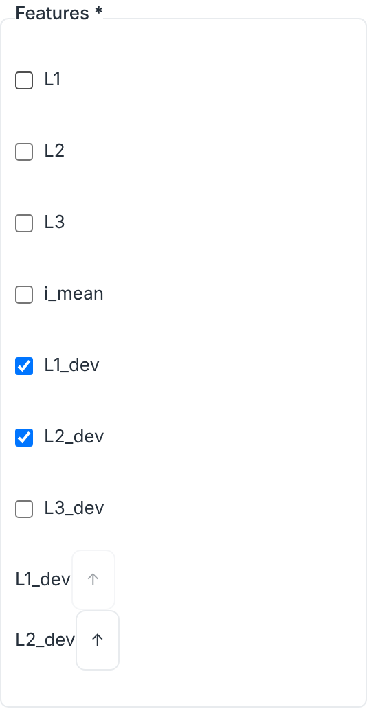
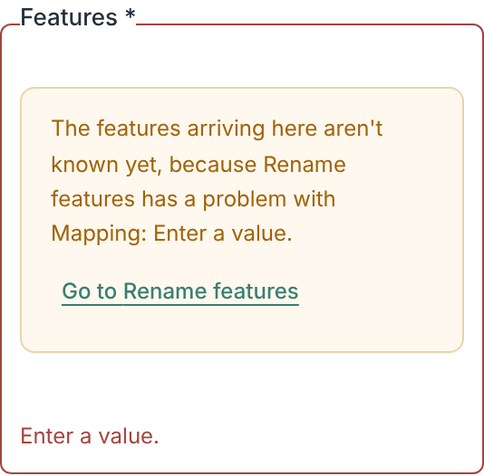
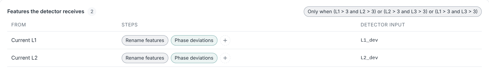

# Monitor three phases together

This page builds one monitor for the three phase currents of a charger, L1, L2
and L3, in the pipeline composer. It explains why the phases belong in one
monitor, then sets it up step by step. The same design fits phase voltages or
any group of readings that should move together.

## Audience

- Operators who create monitors in the pipeline composer.

## Why one monitor for three phases

The three phases of a charger carry the same load. When a car starts charging,
when load management lowers the current limit or when the battery tapers off at
the end, all three move together. That shared movement is the *common mode*. It
is large, frequent and normal, so a monitor that watches each phase on its own
learns that big jumps are normal, and then misses the faults that matter.

Those faults show up as a phase that moves *differently* from the others: a
phase that drops out, a step in the imbalance, a sensor whose gain drifts, or a
reading that sticks while the others go on. That is the *differential mode*. It
is small next to the load changes, but it is exactly what a healthy charger does
not do.

So the monitor below takes the common mode out first. It divides each phase by
the mean of the three and subtracts 1, so a phase at the mean reads 0 and one
that carries 4 % more reads +0.04. Load changes cancel, and what is left is the
balance between the phases.


The deviations also keep the normal imbalance of a charger, such as L3 always
sitting a little above the others. A detector learns that standing pattern from
a training period and reports when the pattern changes. A **Static baseline**
fits this well: it learns from a fixed reference period, so a fault that
develops slowly, such as a drifting sensor, does not become the new normal.

## What you build

```text
Inputs → Rename → Gate → Aggregate → Formula for each → Select → PyOD PCA → alarm policy
```



| Step | What it does here |
| --- | --- |
| Rename features | Gives the readings short names, L1, L2 and L3, to write formulas with. |
| Gate | Monitors only while the charger charges on at least two phases. |
| Aggregate | Adds the mean of the three phases, `i_mean`. |
| Formula, for each feature | Adds `L1_dev`, `L2_dev` and `L3_dev`: each phase over the mean, minus 1. |
| Select features | Hands two of the deviations, `L1_dev` and `L2_dev`, to the detector. |
| PyOD PCA | Learns how the deviations normally relate, and scores how far an observation strays from that. |

## Step by step

Open **Monitoring**, then **Create**.

### 1. Choose the readings and the strategy

Under **Choose monitoring inputs**, pick the charger and check its three phase
currents. Name the service, for example *Charger 07 phase balance*. Set
**Strategy** to **Static baseline**. The composer starts with the inputs, a
detector, an alarm policy and the evidence output, already connected.

### 2. Rename the readings

On the wire after the inputs, choose **+** and **Rename features**. Under
**Mapping**, write `L1`, `L2` and `L3` next to the three readings.

{ width="320" }

Renaming is optional. Formulas can use the reading names as they are, but short
names make the next steps easier to write and to read.

### 3. Monitor only while the charger charges

Insert a **Gate** after Rename and give it this condition:

```text
(L1 > 3 and L2 > 3) or (L2 > 3 and L3 > 3) or (L1 > 3 and L3 > 3)
```

{ width="320" }

The condition holds while at least two phases carry more than 3 A. Between
sessions every phase is near 0, and dividing by a mean near 0 makes no sense.
The Gate also keeps idle time out of what the detector learns. Observations the
Gate holds back are recorded but neither learned nor scored, and they do not
count as coverage gaps. Requiring two phases, not three, keeps a monitor running
when one phase drops out, which is one of the faults you want to see. A car that
charges on one phase only is not monitored; that is normal and not a fault.

### 4. Add the mean of the phases

Insert an **Aggregate** after the Gate. Leave **Function** at **Mean** and
**Applies to** at every feature, set **Name** to `i_mean` and choose **Keep
features**, so L1, L2 and L3 stay and `i_mean` is added.

{ width="320" }

### 5. One formula for all three deviations

Insert a **Formula** after the Aggregate and choose **For each feature**. The
composer checks the readings that arrive, here L1, L2 and L3, and leaves
`i_mean` unchecked. Write:

```text
x / i_mean - 1
```

`x` stands for each checked feature in turn. Choose **Add new features** and
set **Suffix** to `dev`. The step now adds `L1_dev`, `L2_dev` and `L3_dev`, and
the sentence below **Result** names them. A step title such as *Phase
deviations* makes the card easy to find.

{ width="320" }

The card shows one warning: *Division by i_mean: observations where it is 0 are
skipped.* The check cannot tell that the Gate already rules this out, so the
warning stays. It does not block the monitor.

A single Formula for each feature replaces three separate ones, such as
`L1 / i_mean - 1` named `d1` and so on. Both compute the same values; the
single step is shorter to set up and keeps the three in step when you change
the formula.

### 6. Hand the deviations to the detector

Insert **Select features** after the Formula and check `L1_dev` and `L2_dev`.
The detector then sees only the balance between the phases, not the load.

Two are enough. The three deviations always add up to 0, so `L3_dev` is minus
the sum of the other two and carries nothing new. Handing all three to a
detector also makes it numerically unstable: their spread is exactly 0 in one
direction, and PCA divides by that spread. A change in L3 still shows, because
it moves the mean and with it `L1_dev` and `L2_dev`.

{ width="320" }

If the list stays empty and says the features *aren't known yet*, an earlier
step has a problem, such as a Rename with nothing filled in. The message names
that step, and **Go to** opens it. Once it is fixed, the list fills.

{ width="320" }

### 7. Choose the detector

Select the detector card and set **Detector model** to **PyOD PCA**. PCA learns
the directions in which the deviations normally vary together during training,
and scores an observation by how far it lies outside them. A phase that drifts,
drops or sticks breaks that pattern even when every single value is in a normal
range. Leave the alarm policy as it is to start with.

### 8. Check what the detector receives

Switch from **Graph** to **Features**. Each row is one feature the detector
receives, with the reading it follows and the steps that change it. The Gate's
condition sits above the rows, because it decides which observations reach all
of them.



The validation badge should read **Valid** with the one division warning from
step 5. **Apply monitoring** starts the service.

## Training period

A Static baseline learns from the first observations that pass the Gate, then
calibrates, then scores. The badge says how long that takes at the readings'
usual rate, such as *first alarm after ≥ 4 h 20 min*; with a Gate it is *at
least*, because held-back observations do not count. Train on a period with
several ordinary charging sessions at different currents. If the charger has a
known fault at the time, wait until it is repaired, or the detector learns the
fault as normal.

## Reading the chart

The chart of a running service shows the readings, then a **Detector inputs**
pane with `L1_dev` and `L2_dev`, then the sequential evidence. The deviations
show what the detector sees: they stay flat through load changes and step when
the balance between the phases changes. The evidence pane shades the alarm zone
above the threshold. Readings newer than the last scored one count as *awaiting
score*. While the Gate holds readings back, for example between charging
sessions, that count grows; it is not a backlog, and it resets once a reading is
scored again.

## Variations

- **Phase voltages.** Use the same steps with the three voltages and a Gate such
  as `min(V1, V2, V3) > 100` to skip outages.
- **Adaptive stream.** With an adaptive strategy, **Aberrant
  MovingMahalanobisDistance** on the same two deviations works the same way. An adaptive detector keeps learning, so it follows a slow drift
  instead of reporting it; use a Static baseline when slow faults matter.
- **One number for the imbalance.** A Formula such as
  `max(abs(L1_dev), abs(L2_dev), abs(L3_dev))` gives the largest deviation as
  one feature, for a univariate detector or a chart.

[Monitoring](monitoring.md) describes every step and setting in the composer.
