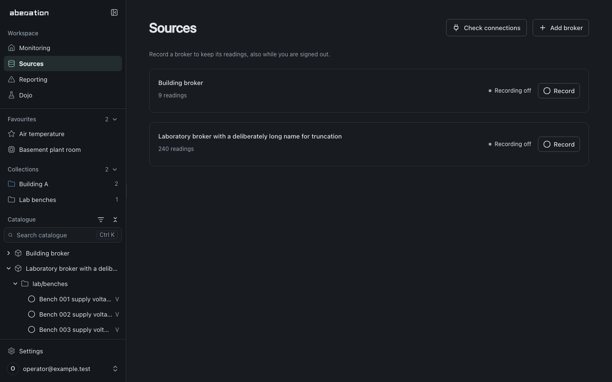
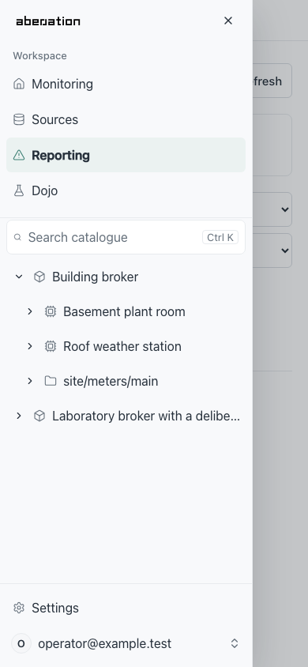

# User guide — web app

This page explains end-user workflows in the React frontend.

## When to use this page

Use this page for account, device, favourites, monitoring-service, and anomaly workflows in the UI.

## Audience

- Platform users and operators interacting with the web app.

## Main routes

| Route | Purpose | Access |
| --- | --- | --- |
| `/register` | Accept an invitation and set a password | Public |
| `/verify` | Retired; redirects to `/login` | Public |
| `/login` | Sign in | Public |
| `/forgot-password` | Request a password reset | Public |
| `/reset-password` | Set a new password with a reset token | Public |
| `/` | Monitoring services and selected-source evidence | Authenticated |
| `/details/:chargerId` | Telemetry details for one charger | Authenticated |
| `/services` | Legacy link to Monitoring | Authenticated |
| `/sources` | Sources: configure brokers, HTTP APIs and recorded readings | Authenticated |
| `/anomalies` | Reporting: review recent anomaly events | Authenticated |
| `/dojo` | Dojo: datasets, labels, offline runs and comparisons; `?dataset=<id>&tab=values\|runs\|compare` opens one dataset | Members who may use the Dojo |
| `?settings=<section>` | Settings overlay above any workspace page: `account`, `preferences`, `catalogue` or `status` | Authenticated |
| `/account` | Legacy link: opens the Account settings section above Monitoring | Authenticated |
| `/system/status` | Legacy link: opens the System status settings section above Monitoring | Authenticated |

## Workspace navigation

All navigation lives in one sidebar on the left; there is no top navigation bar.
From top to bottom it holds:

- **Aberration** (the logo), which returns to dashboard home, and the
  **Hide sidebar** control.
- **Workspace**: **Monitoring**, **Sources**, **Reporting** and, for roles with
  the Dojo permission, **Dojo**. The current workspace is highlighted. Device
  details opened from a report keep **Reporting** highlighted. Pipelines and
  datasets stay where they were: in Monitoring and in Dojo.
- **Favourites**: your starred readings and devices, when you have any.
- **Collections**: the catalogue's shared collections, when it has any.
- **Catalogue**: search and a tree of brokers, devices, MQTT topic levels and
  readings.
- **Settings** and your account at the bottom. They stay in view however long the
  catalogue is.

Favourites and Collections fold away from their headings, and the sidebar
remembers which are folded.

### Choosing a source

Selecting a catalogue row, or a favourite, chooses that broker, device, topic or
reading as the source for the current workspace. Monitoring shows its services
and previews a reading. Sources shows its metadata and recording configuration;
a selected device lists its readings so you can configure one. Reporting shows
events involving it. The chosen row is highlighted in the sidebar.
**Show all sources** on the page clears the choice.

Choosing a branch also opens it. Opening or closing a branch with its chevron
changes only what the tree shows, never the chosen source. The source is part of
the URL, so links, reloads and the browser's Back and Forward buttons keep it.
Workspace links carry it from one workspace to the next.

### Browsing the catalogue

Brokers contain their devices, and devices may contain other devices. Below them
come MQTT topic levels. A level without branches is shown as one row, such as
`weather/roof`. Readings show their display name and unit; hover a row for its
full name and MQTT address. Readings a broker receives without a device sit
directly under the broker. An HTTP API is listed like a broker, with the levels
of its request paths below it, such as `/v1/stations`. Readings that have not received anything recently
stay in the tree.

Search matches names, identifiers, units and full MQTT paths. Results are a flat
list, each with its topic and the device or broker it belongs to. Typing never
changes the chosen source. Clear the search (Escape in the field) to return to the
tree as you left it, with the same open branches and scroll position.
Ctrl+K (Cmd+K on a Mac) opens the sidebar if needed and focuses search.

In the tree, Up and Down move between rows, Home and End jump to the first and
last row, Right opens a branch or moves into it, Left closes it or moves to its
parent, and Enter chooses the row. **Collapse all** closes every branch.

Choosing a collection narrows the tree to that collection's members. The tree
then shows **In** followed by the collection's name, and **Show every source**
(×) returns to the whole catalogue. Choosing a collection does not change the
chosen source.

### Showing and hiding the sidebar

**Hide sidebar** gives the page the full width; **Show sidebar** at the top left
brings the sidebar back. Toggling it keeps the page at the same vertical position.
Drag the sidebar's right edge to resize it, or focus the
edge and use the arrow keys. Double-click the edge to restore the default width.
The width, whether the sidebar is shown, open branches, folded categories, the
chosen collection and the **Recently active** filter are remembered for your
account in this browser. If browser storage is unavailable, they last for the
session.

On phones, **Show sidebar** opens the same sidebar as a drawer. Choosing a
workspace or source closes it. **Close navigation**, Escape or a tap outside also
closes it, and focus returns to **Show sidebar**.

{ width="640" }
{ width="240" }

## Authentication workflow

1. Ask your organization administrator for an invitation.
2. Open the invitation link and choose a password of at least 12 characters.
3. Log in and receive a bearer token.
4. The frontend API client attaches that token to subsequent requests.

Opening a protected link while signed out takes you to **Sign in**. After login,
you return to that page with its selected item, filters and URL fragment intact.
The destination also survives reloading the login page or signing in again after
your session expires. Opening the login page directly takes you to Monitoring.
Application invitations and member roles control access; the GitHub allowlist for
infrastructure administration is separate.

With **Remember this device**, the access token stays in memory and is restored from an HttpOnly session cookie through `/v1/auth/refresh`; otherwise it lives in session storage for the tab. In local development, invitation and password-reset messages are available in Mailpit at <http://localhost:8025>.

**Account → Signed in** shows your email, your role and what it lets you change.
Members whose role can manage members handle invitations, roles and access under
**Account → Members** and **Account → Roles**. Disable a member to revoke
their access. Once disabled, **Remove** permanently deletes their account and personal
favorites after confirmation. Shared catalogue data, monitoring services and reports
are kept. A removed member needs a new invitation to return.
Every member can view the shared workspace and edit their own favorites. A role
adds permissions to manage sources, monitors, alarms or members; Administrator
holds all of them. Controls a role does not cover stay hidden.

## Settings and system status

Open **Preferences** from the account menu at the bottom of the sidebar
to choose **Light**, **Dark**, or **Follow system** under **Appearance**. Changes apply immediately and are saved in this browser on
this device. Follow system also responds to changes in the device's appearance.
Settings opens over the current page, preserving your workspace and unsaved input.
Close it with the close button or Escape to return to the page.

Account, Preferences, Catalogue and System status share one settings overlay. It
opens above the page you are on, which keeps running underneath, and closing it
(the close button, Escape, a click outside or the browser's Back button) returns
you to that page as you left it. The open section is part of the address, for
example `/sources?settings=status`, so it can be linked to and survives a reload.
Switching sections does not add browser history.

Open **System status** from the account menu for live collection diagnostics, database size and
retention information. Collection status refreshes automatically every three
seconds; **Refresh storage** requests updated database measurements. The former
`/system/status` and `/account/settings` links open this section above Monitoring.

Select your email at the bottom of the sidebar to open the account menu with
**Account**, **Preferences**, **Catalogue**, **System status** and **Log out**.
**Account** shows who is signed in and, for members who manage members, member
access and roles. **Catalogue** opens catalogue configuration; adding or editing
an entry opens the editor on top of it. An empty catalogue also offers **Open
catalogue settings** in the sidebar.

## Readings and telemetry workflow

1. Browse the MQTT catalogue or search for a reading.
2. Select the reading in **Monitoring** to see its latest value, age and history.
   Hover over the age for the exact timestamp or open **Source details** for the catalogue path.
3. Switch to **Sources** to inspect or change the selected reading's recording policy.
4. Open its monitoring service to review detector evidence and configuration.

Device details at `/details/:deviceId` show a device's recorded readings with
category and time-range controls. Readings of a broker that have no device open
at `/details/broker/:brokerId`.

## Data-source activity

Topic and reading circles in the catalogue show activity from a live preview or
background recording. A filled circle means a fresh message arrived in the last
30 seconds. A hollow circle means the source is waiting for fresh data or is not
listening; hover or focus the row to see its description. Retained snapshots and
stored history do not count as fresh traffic. Browsing alone starts no collection.

The **Recently active** filter icon beside the **Catalogue** heading keeps
filled-circle readings and the paths leading to them. It also filters search and
the members of a chosen collection, updates as traffic starts or becomes stale, and
remembers your choice in this browser. Favourites stay listed. Turn it off to show
the full catalogue again. Filtering keeps the current source selected and does not
start a connection or change recording. An empty filtered tree shows **No recently
active topics.** with an underlined **Show all topics** action beneath it. This
turns off the filter and keeps your open branches, search and source selection.

Configure recording under **Sources**. Broker and topic policies can cover several
readings; review the affected scope before applying changes. Including readings
added later requires an explicit opt-in. Roles that manage sources can also use **View live**
to preview configured sources whose recording is off, and **Stop live view** to end
that preview. Previewing does not enable background recording.

**Add broker** offers two types. An **MQTT broker** sends messages on topics. An
**HTTP API** is asked for a request path at an interval: give it a host, a port
and a scheme, then add readings with a request path such as
`/v1/stations/7/latest` and the payload field to read from the reply. Recording
an HTTP API starts at one request a minute; choose another interval under
**At intervals**. If the reply states when its value was measured, enter that
field as the reading's **Source timestamp**, and a repeated measurement is
recorded once. Your operator decides which APIs may be reached.

## Favourites workflow

1. Star a service in Monitoring or a reading in its preview.
2. Select **Favourites** in the Monitoring service filters to show starred services.
3. Starred readings and devices appear under **Favourites** in the sidebar;
   select one to choose it as the source.

Favourites belong to your account and follow you to every browser. Agents and
scripts read and change the same list through `/v1/favorites`.

## Services workflow

The [visual monitoring guide](monitoring.md#visual-monitoring-pipelines) explains
templates, the typed graph, reading selection and live inspection.

Open **Monitoring** at `/` to inspect monitoring services. The view refreshes service state and shows the strategy and processing stage reported by the backend. Removing a service also releases its claimed readings.

## Reporting workflow

1. Open **Reporting** at `/anomalies`.
2. Review events grouped by day. Each event names its device, or its broker for
   readings without a device, and the readings it is about.
3. Narrow the events by reading, time range and p-value. With several devices in
   scope, each reading is listed with its device's name.
4. Open a source or signal to inspect its readings around the event, or open the
   detection description for the full anomaly. Multivariate events show their
   involved signals without attributing a cause to an individual sensor.
5. Use **Copy link** to share an anomaly with another signed-in member. The event
   ID remains available under **Technical details** for API requests and logs.
6. Select individual rows, select all matching events across pages, or choose
   **Delete all** to clear the current scope and filters. Review the exact count
   before confirming. New arrivals are excluded, and deletion cannot be undone.

The compact **Latest** status shows recency; hover over it for the exact time.
Detector results describe statistical evidence, not operational severity.

## Dojo workflow

The Dojo tries detection designs on stored data before anything is monitored
live. Nothing in it claims readings, starts monitors or writes to Reporting.

1. Open **Dojo** at `/dojo`. **Upload CSV** copies a file into a new dataset;
   **Copy recorded readings** copies the numeric readings of the device or
   reading selected in the catalogue: everything still stored, the last 30
   days, 7 days or 24 hours, or a window you type. **Copy to Dojo** on a
   device's Reporting page, and on a reading or device preview in Monitoring,
   does the same for that device or reading without a catalogue selection and
   opens the new dataset. A dataset is frozen: retention and catalogue edits
   never change it.
2. Open a dataset. **Values and labels** shows its series; zoom the chart to a
   known problem and choose **Use the zoomed range**, or type the window, then
   **Add label**. Labels may touch but not overlap. For a dataset copied from
   recorded readings, **Recorded alarms** lists the alarms live monitors
   raised on those readings during its time span, grouped when they came less
   than ten minutes apart; **Add as label** keeps one as it is, **Adjust**
   puts it into the form first, and **Add all as labels** takes every one no
   label covers yet.
3. **Runs** starts a run: choose a template or a design from the library, check
   which series feeds each input, and start it. The run replays the dataset in
   time order through the same alignment, learning and scoring as a live
   monitor; its progress updates while it runs. Tick **Compare calibration
   methods** to have the run also try the fixed split and every calibration
   method that adapts on its own detector scores. The run takes longer. A
   design that alarms on a conformal martingale has no boundary on its scores,
   so the option is off for it.
4. **Compare** puts up to six finished runs side by side (the three newest are
   ticked when it opens): their alarms under
   the values, how many labels each detected and how soon, and how many false
   alarms each raised per day outside the labels. The best value of a metric is
   bold. Editing a label re-scores every run at once. Below, **Calibration
   methods** ranks what a run that compared them found: for each method, how
   many labels it would have detected and how soon, its false alarms per day
   and the share of results it would have alarmed on. Every method saw the
   same scores at the same alarm rate; the row marked **This run** is the
   design's own calibration step with its settings, the others run with their
   defaults. A method that stopped on an error is listed last with the reason
   and shows only what it found until then. To use a better method, change the
   design's calibration step.
5. **Use as template**, on a finished run, saves its design to the template
   library; it needs the permission to manage monitors. **Start a monitor**
   then opens the template in Monitoring with each input set to the recorded
   reading its series was copied from, where that reading is still collected
   and fits. Inputs fed by an uploaded series are chosen there.

## Expected errors and operator actions

| UI message pattern | Typical cause | Action |
| --- | --- | --- |
| Login failed or unauthorized | Invalid credentials, expired session, or unverified account | Verify the account and sign in again |
| No brokers configured yet | The catalogue has no brokers | Add a broker in Sources or import a catalogue |
| Telemetry request failed | API or database latency/outage | Check API Gateway, TACTIC, and database health |
| Monitoring start failed | Invalid configuration, a reading that is not recorded as a number, readings of different devices, or orchestration failure | Record the readings under **Sources**, retry with defaults and inspect TACTIC logs |

## Related pages

- [Monitoring](monitoring.md)
- [Backend API](../reference/backend-api.md)
- [Testing and debugging](../development/testing-debugging.md)
